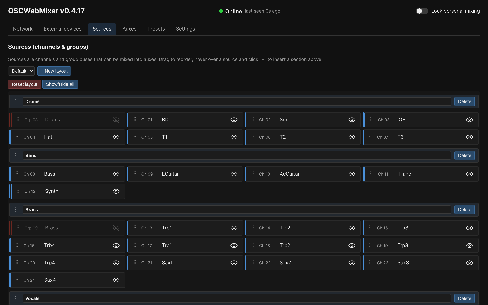
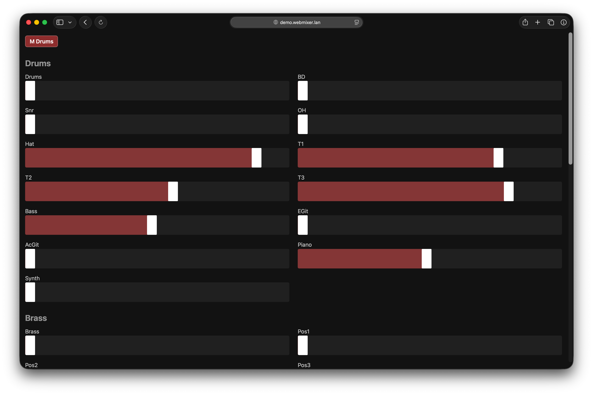

# OSCWebMixer-Go

A complete rewrite of [castles/OSCWebMixer2](https://github.com/castles/OSCWebMixer2) in Go.

OSCWebMixer-Go is a service that lets DiGiCo users add an easy-to-use, web-based personal monitor mixing system to their consoles, as well as the ability to use multiple iPads with the native DiGiCo remote app simultaneously.

Runs on anything that runs Docker, but if you want a tested, plug-and-play system with support included, see [Buy pre-configured hardware](#buy-pre-configured-hardware) below.

## Features

OSCWebMixer-Go implements the core features of OSCWebMixer2:

- **Simple Personal mixing UI:** Visually similar to OSCWebMixer2's mixing interface.
- **Admin panel:** Configuration via web-based admin panel.
- **Mixer organization:** Sortable channels, icons/colors for auxes, and channel section headers.
- **DiGiCo Pad connection:** OSC-based "DiGiCo Pad" connection to the console with built-in OSC multiplexing, so an iPad can still connect via the native DiGiCo remote app at the same time.

### Differences to OSCWebMixer2

- **Group Bus Support:** In addition to input channels, group buses can also be mixed into auxes now.
- **Custom assignable layouts:** You can now create custom source layouts that are assignable to any aux bus.
- **Multi-select sources:** Multiple sources can be selected and reordered together, making layout configuration quicker.
- **Performance:** The new multi-threaded architecture makes it possible to use more personal mixing clients and iPads simultaneously without problems, while using 1/4 the memory and half the CPU of the old version.
- **Console Healthcheck:** OSCWebMixer-Go detects when the console goes offline and shows a status message on all clients until the connection is restored.
- **Session Reload:** When reloading the session on the console, the changes are automatically adapted in OSCWebMixer-Go.
- **Auto-hide patterns:** It is now possible to automatically hide channels from the personal mixing UI that match a pattern (e.g. FX buses, unnamed channels,...)
- **Personal Mixing Lock:** Personal mixing can now be locked for all clients in the Admin panel. This is useful when making configuration changes while musicians are already connected.
- **Preset Import/Export:** Presets can be downloaded as JSON files (individually or all at once) and re-uploaded later or on another instance, making it easy to back up or share a configuration.

> [!NOTE]
> Icons for channels and plugin support are not implemented as of now. \
> I'll consider re-adding these if there's demand for them.
>
> Generally, feel free to open a [feature request](https://github.com/mederham/oscwebmixer-go/issues/new) in the issue tracker of the repo.

## Screenshots

Admin panel | Mixer frontend
:---:|:---:
 | 

More screenshots: [docs/screenshots.md](docs/screenshots.md)

## Buy pre-configured hardware

> [!TIP]
> If you want a ready-to-use solution, I offer MikroTik routers ([hAP ax3](https://mikrotik.com/product/hap_ax3) or [L009](https://mikrotik.com/product/l009uigs_2haxd_in)) with OSCWebMixer-Go pre-installed and a custom network configuration, starting at €300.
>
> The router also includes a pre-configured Wi-Fi access point for personal mixing clients to connect to, so you don't need to set up any networking yourself. Built into your console case, OSCWebMixer-Go is ready to go as soon as it's powered on.
>
> OSCWebMixer-Go is designed to mainly run on these routers, but it runs anywhere Docker does (see [Usage](#usage) below if you'd rather self-host). With the router, you additionally get a complete system tested for reliability, custom network configuration matching your setup, and support for both the app and the MikroTik configuration.
>
> OSCWebMixer-Go is free and open source, so buying a router is also a great way to support its development.
>
> Contact me at [sound@georghameder.at](mailto:sound@georghameder.at) to order or ask questions.

## Usage

### Docker (recommended)

> [!NOTE]
> **Docker Desktop users:** Docker Desktop (Mac/Windows) masks the desk's real IP with its VM gateway address. The masked IP address is not trusted by OSCWebMixer per default, so the console connection cannot be established.
>
> Set `OSCWEBMIXER_DESK_TRUSTED_IPS` to trust the VM gateway IP(s) if you use Docker Desktop (default is `192.168.65.1`) - uncomment it in [docker-compose.yaml](docker-compose.example.yaml), or add it to the CLI command.

#### Docker Compose

Copy [docker-compose.example.yaml](docker-compose.example.yaml) to `docker-compose.yaml` and adjust it, or start from scratch:

```bash
docker compose up -d
```

#### Docker CLI

```bash
docker run -p 80:80 -p 8000:8000/udp -v ./config:/webmixer/config ghcr.io/mederham/oscwebmixer-go:latest
```

This runs the OSCWebMixer-Go container without any environment variables.

### Running with `go run`

Run directly with `go run` instead of building a Docker image - useful for local development:

```bash
OSCWEBMIXER_HTTP_PORT=8080 go run ./cmd/oscwebmixer
```

This starts OSCWebMixer on `http://localhost:8080`. 

Run `go run ./cmd/oscwebmixer --help` for the full list of CLI flags.

Environment variables can also be used when executing OSCWebMixer-Go like this.

### Environment variables

Variable | Default | Description
---|---|---
`OSCWEBMIXER_HTTP_PORT` | `80` | Port for the admin panel and mixer UI.
`OSCWEBMIXER_DESK_IP` | _(none)_ | Desk IP address. Reconfigures the desk connection on every restart; see note below.
`OSCWEBMIXER_DESK_PORT` | `9000` | Desk port. Same restart behavior as `OSCWEBMIXER_DESK_IP`.
`OSCWEBMIXER_OSC_PORT` | `8000` | Local UDP port the app listens on for OSC from the desk.
`OSCWEBMIXER_DESK_TRUSTED_IPS` | _(none)_ | Comma-separated list of extra source IPs to treat as the desk, e.g. `192.168.65.1,192.168.65.2`. For Docker Desktop only — see [note above](#docker-recommended).

`OSCWEBMIXER_DESK_IP` and `OSCWEBMIXER_DESK_PORT` can still be changed afterwards in the admin panel, but reset to the environment value on every container restart. To keep a connection configured via the admin UI instead, remove those two variables. `OSCWEBMIXER_DESK_TRUSTED_IPS` is not exposed in the admin panel.

## License

MIT, see [LICENSE](LICENSE).

Instrument icons in [web/admin/icons/](web/admin/icons/) are from [castles/OSCWebMixer2](https://github.com/castles/OSCWebMixer2), MIT License, Copyright (c) 2024 Marc.
