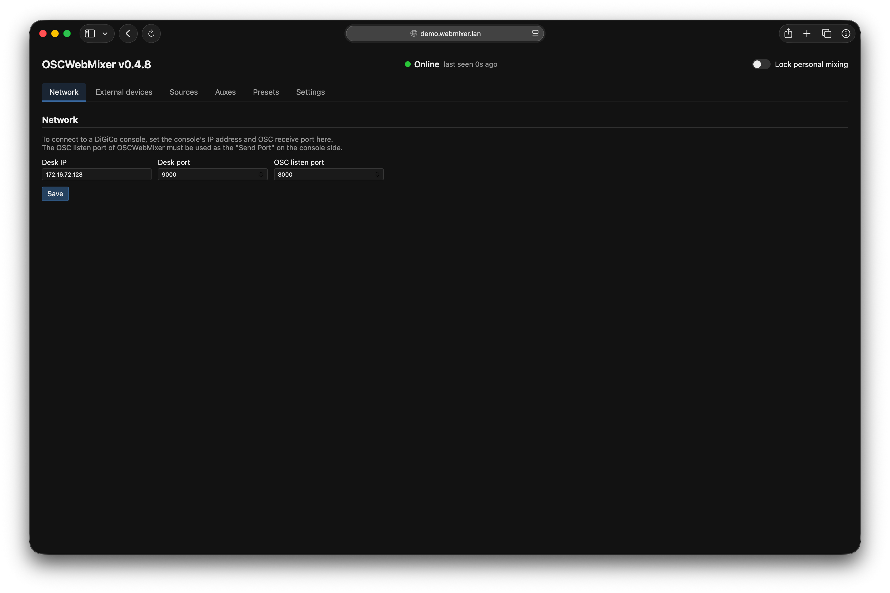
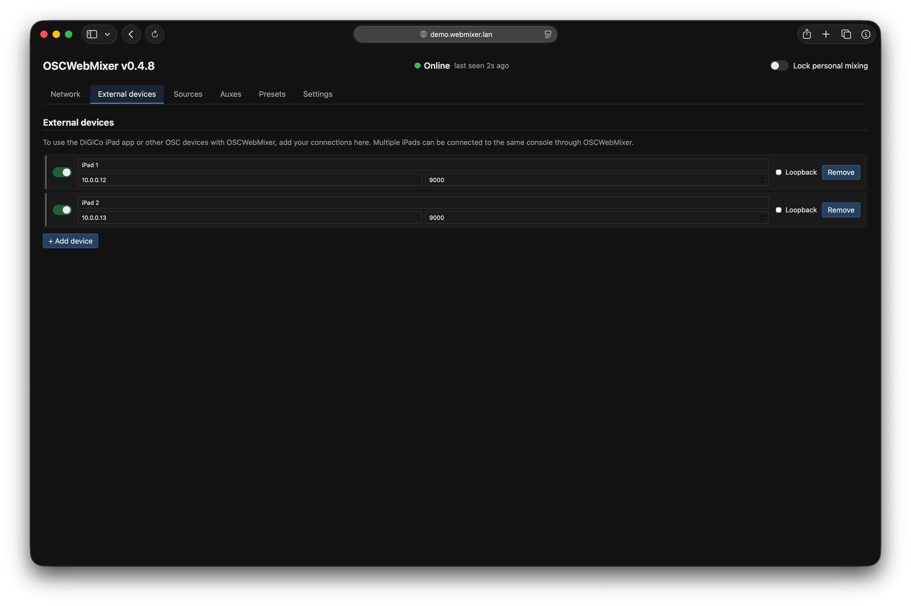
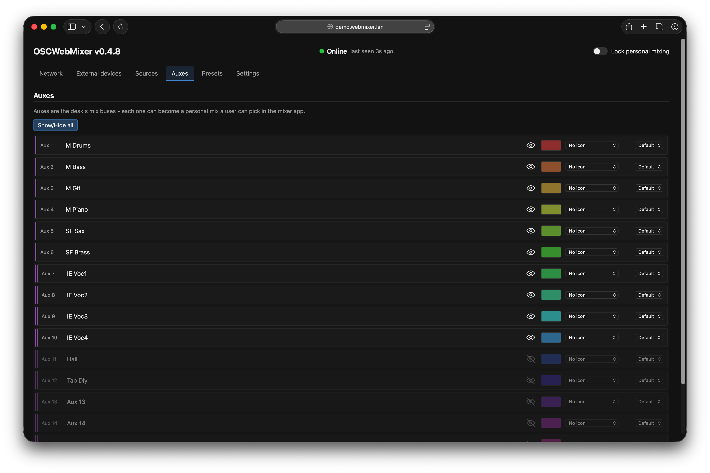
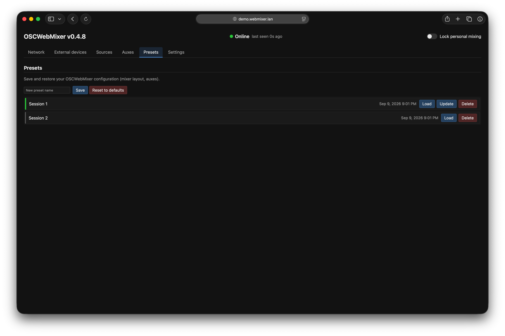
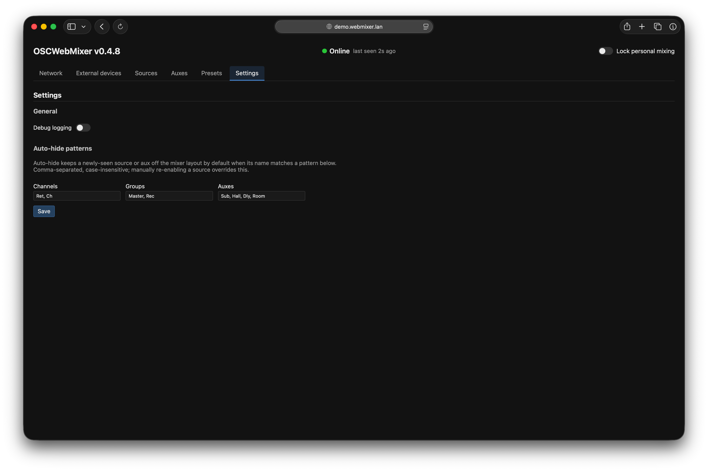
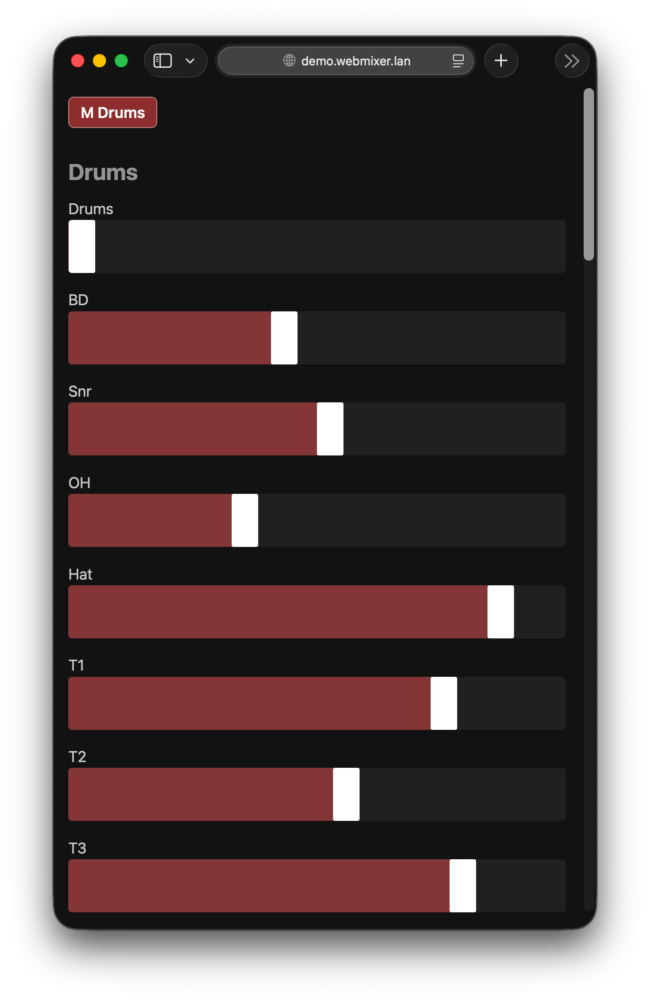
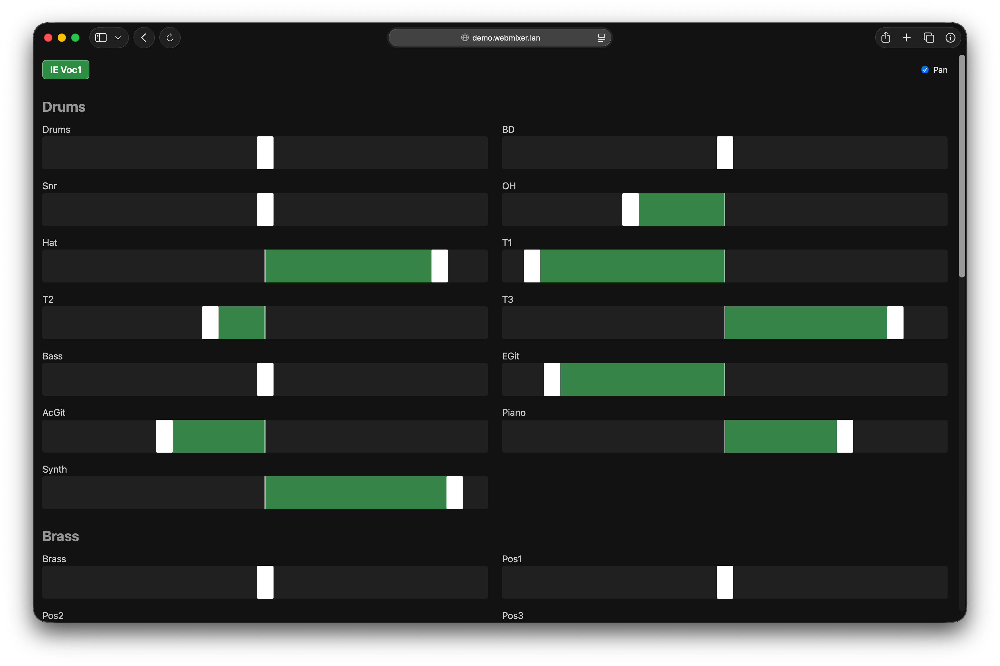
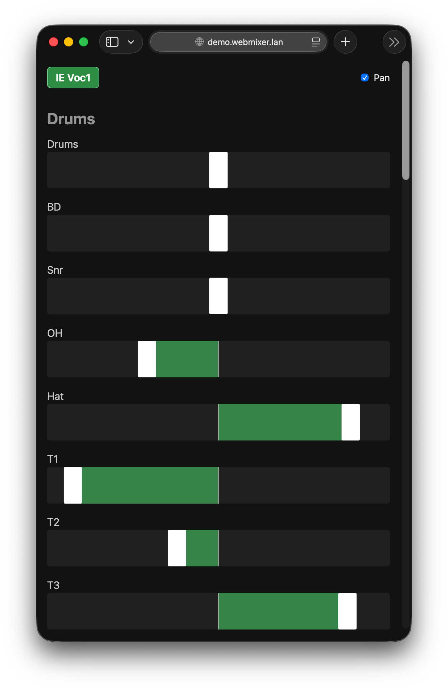
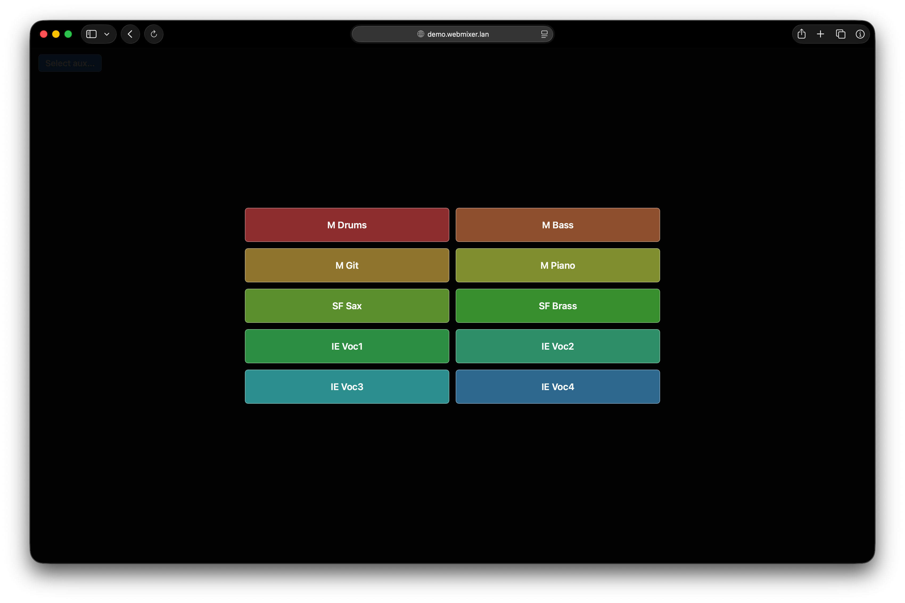

# Screenshots

[← back to README](../README.md)

## Admin panel

### Network

### External devices

### Sources

### Auxes

### Presets

### Settings

## Mixer frontend

### Levels view

Landscape | Portrait
:---:|:---:
 | 

### Pan view

Landscape | Portrait
:---:|:---:
 | 

### Aux select

